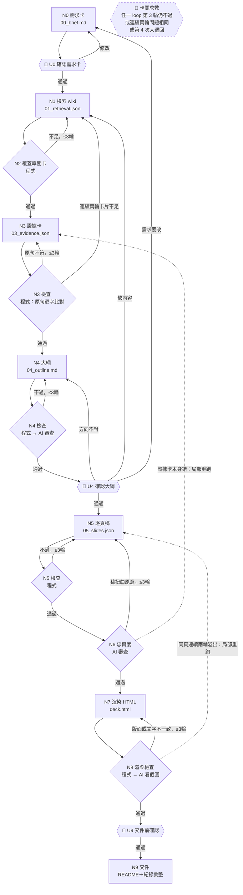

# 大學生防詐指南：用 Graph Workflow 生成的教學簡報

- **成品**：[deck.html](deck.html)。單一 HTML 檔，共 17 頁（graph v2 第 2 次執行），用 ← → 翻頁，N 鍵切換講者備註；電腦版 1280×720。v1 成品留在 [work/v1/deck.html](work/v1/deck.html)
- **唯一知識來源**：[`wiki/`](../wiki/)。每頁底部的來源列都連到對應的 wiki 頁面
- **graph 規格**：[graph.md](graph.md)（目前 v2，git tag `graph-v2`；v1 為 tag `graph-v1`）
- **執行紀錄**：第 1 次（v1）[logs/run_20261113-112943.md](logs/run_20261113-112943.md)、第 2 次（v2）[logs/run_20261114-170936.md](logs/run_20261114-170936.md)；版本比較：[logs/compare.md](logs/compare.md)

## 一、流程圖

虛線是**大退回**，只重做受影響的證據卡和引用它的頁面。U9 不通過時由使用者指定退回哪一關，圖上省略。

## 二、說明

### 哪些步驟會重複執行
每個「生成 → 檢查」組成一個小 loop，不通過就在 loop 內重做：L1（N1↔N2）、L3（N3）、L4（N4）、L5（N5↔N6）、L7（N7↔N8）。
- 每個 loop 最多 3 輪；同一個問題連續兩輪沒有改善，就提早停下來求救
- 重做時只把「失敗清單」交給全新的 subagent，不交整段對話，避免它沿用舊的錯誤思路

### 哪裡檢查、哪裡重新生成
- **程式檢查**（`checks/*.py`）負責能明確判對錯的規則：
  - 證據卡原句和 wiki 逐字比對
  - 投影片上的數字一定要出現在引用卡片的原句裡
  - 來源列要等於引用卡片的 wiki 頁面
  - 字數、補充內容的規則、測驗的卡號
  - 用 Playwright 開瀏覽器檢查桌機和手機版有沒有溢出、文字和逐頁稿是否一致
- **AI 審查**（每次都開全新的 subagent，只給成品和來源）負責要判斷的部分：教學順序、有沒有扭曲原意、看截圖判斷版面
- **使用者**在 U0（需求卡）、U4（大綱）、U9（成品）三個關卡確認
- 同一個節點先跑程式，程式通過才交給 AI 審查

### 為什麼這樣設計
1. **N3 之後和 wiki 隔開**：寫大綱、寫逐頁稿、做 HTML 的節點都讀不到 wiki，只能用證據卡，所以每句話都追得到「卡號 → wiki 原句」。只有 N6 會回頭讀 wiki，檢查證據卡本身有沒有抄錯
2. **退回到錯誤產生的那一關**：退回表寫在 `config.json`，`log_event.py` 會擋下表上沒有的退回路徑
3. **局部重跑**：大退回時先存快照，只重做受影響的卡片和頁面，程式會確認範圍外的內容一字不動（「第 6 頁講錯，其他 14 頁不動」）
4. **記錄「在哪裡發現」與「在哪裡產生」**：兩者不同就代表錯誤太晚才被發現，檢查應該往前移，這是改版時的依據

## 三、第 1 次執行摘要（20261113-112943，graph v1）

| 指標 | 數值 |
|---|---|
| 檢查次數 | 50（程式 24、AI 16、人工 10） |
| 不通過 | 16 次 |
| 大退回 | 1 次（N6 → N3，局部重跑 5 頁，14 頁不動） |
| 卡關求救 | 1 次（N4 第 3 輪） |
| 最常出錯的節點 | N4 大綱（7 次），其次 N8 渲染檢查（3 次） |
| 錯誤類型 | 扭曲原意 4、缺來源 4、版面溢出 4、數字不符 3、覆蓋不足 3、結構缺段 2 |
| 晚發現 | 7 次（N8→N7 ×3、U9→N7 ×2、U4→N0 ×1、N6→N3 ×1） |

### 值得反思的事件
- **wiki 本身有缺口**：解除分期付款、假投資、色情應召三種手法在 wiki 裡沒有具體案例，到了 N4 才發現。N2 只檢查頁數夠不夠，沒有檢查「需求卡要的東西 wiki 有沒有」，可以考慮把這項檢查往前移到 N2
- **wiki 摘要句省略口徑**：wiki 的摘要句寫「6.29 分鐘就換成虛幣」，但表格的原始指標是「轉移 50% 款項的平均時間」。N3 照原句逐字抄，所以程式檢查抓不到；N4 的 AI 審查也只發現「拿掉了交易所前提」，一直到 N6 回頭讀 wiki 才找到真正的問題，觸發本次唯一一次大退回
- **檢查程式本身出錯 2 次**：N3 把「第 3，12–17 歲」的逗號當成千分位，讀成 312；N8 的 Google Fonts 白名單要求網址結尾有斜線，所以擋下了 preconnect 連結。兩個都修好並單獨 commit（見 graph.md 版本紀錄）
- **AI 審查員看不到 config**：N4 審查員只讀需求卡，不知道測驗頁的字數上限是 160 字，因而誤判，後來把這個例外補進需求卡
- **每次換全新審查員，loop 不容易收斂**：每位審查員都會挑出新的小問題，N4 因此跑了 5 次；可以考慮讓下一輪只複查上一輪指出的問題
- **程式檢查和截圖審查互補**：手機版的解答被固定導覽列蓋住，程式判定「可以捲動」就算通過，是看截圖的 AI 審查員抓出來的
- **AI 說「有張力」，使用者說「沒意義」**：加圖版本的放大數字通過了 AI 審查的「數字有張力」一項，但使用者指出那只是把底下的文字再抄一次，所以只保留了封面的圖

## 三之二、第 2 次執行（20261114-170936，graph v2）

### v2 改了什麼（依第 1 次的紀錄）
把兩個「晚發現」的檢查往前移：
- **案例檢查 N4 → N2**：v1 選了 wiki 沒有案例的假投資、色情應召，到 N4 審查才發現（N4 不通過 7 次）。v2 的 N2 程式先檢查手法頁有沒有案例
- **數字口徑檢查 N6 → N3**：v1 的「6.29 分鐘」少了「轉移 50% 款項」，到 N6 才發現並大退回。v2 的 N3 程式要求：數字若是表格數值，必須有卡片抄下那一列
- 其他：審查員讀得到 config、重審先複查上一輪問題、修 `log_event.py`、N7 只留封面照
- 用 v1 成品測試，兩個新檢查都抓得到 v1 的那兩個問題

### 結果（詳見 [compare.md](logs/compare.md)）
| 指標 | v1 | v2 |
|---|---|---|
| 檢查次數 | 50 | 34 |
| 不通過 | 16 | 12 |
| N4 大綱不通過 | 7 | 3 |
| 人工關卡退回 | 3 | 0 |
| 晚發現 | 7 | 6 |
| 最常出錯的節點 | N4（7 次） | N8（5 次） |

### 值得反思的事件
- **往前移有效**：N1 一開始就選了有案例的中獎通知、假求職，N2 一次通過；N4 審查再也沒有出現「缺案例」；表格數字在 N3 就附上口徑。N4 的審查問題數 5 → 1 → 0 收斂，v1 是每輪冒出新問題
- **往前移沒有消滅所有晚發現**：N6 仍觸發一次大退回，原因換成「證據卡白話句加了 wiki 沒有的推論」（例如「學生最多」被寫成「大學生就是目標」）。這種錯程式比對不出來，只有回頭讀 wiki 的 N6 抓得到
- **最常出錯的節點從 N4 移到 N8**：U4 使用者要求「文字大一點、搭配數據表或圖片」，檢查程式只能確認表上的字來自稿，看不出表格有沒有意思；缺欄頭、看不出在比什麼，是看截圖的 AI 審查員抓到的。檢查程式也因為跟不上新格式誤判一次
- **卡關後的人工決定**：N8 第 3 輪卡關（手機版捲動方式違反約定），使用者決定只做電腦版
- **token 成本**：生成節點用 Fable、每個 subagent 都重讀檔案，中途碰到 3 次用量上限。最後幾次小修改由主流程直接改、審查改用 Sonnet 縮小範圍

## 四、圖片來源

第 2 次執行（目前的 deck.html），皆為 Wikimedia Commons 上的 CC0 照片（原出自 Unsplash）：

| 頁 | 作者 | 授權 | 連結 |
|---|---|---|---|
| S01 封面 | James Sutton | CC0 | https://commons.wikimedia.org/wiki/File:Person_looks_down_at_phone_(Unsplash).jpg |
| S04 詐騙的基本樣貌 | Alejandro Escamilla | CC0 | https://commons.wikimedia.org/wiki/File:Man_with_smartphone_and_laptop_(Unsplash).jpg |
| S09 假求職 | Bench Accounting | CC0 | https://commons.wikimedia.org/wiki/File:Ships_out_today_(Unsplash).jpg |

第 1 次執行（work/v1/deck.html）：S01 封面，Jaroslav Maléř，Pexels License，https://www.pexels.com/photo/man-holding-a-mobile-phone-in-the-dark-19949818/

照片只當裝飾使用，簡報上的文字和數字全部來自 wiki。

## 五、檔案

| 路徑 | 內容 |
|---|---|
| `work/00_brief.md` ～ `work/08_review.json` | 第 2 次執行各節點的成品與檢查結果（`*_r*.json`／`*_r*.md` 是各輪的歷史版本） |
| `work/v1/` | 第 1 次執行（v1）的成品與檢查結果 |
| `work/screenshots/` | N8 的桌機與手機截圖 |
| `logs/events.jsonl` | 每次檢查一行，只追加 |
| `logs/run_<id>.md` | 單次執行彙總 |
| `logs/compare.md` | 各 graph 版本並排比較 |
| `checks/set_source_base.py` | 之後放上 GitHub 時，改寫來源列連結的開頭網址 |
