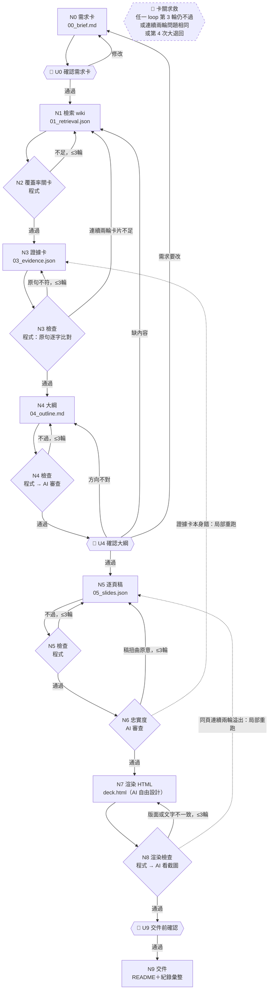

# 防詐簡報 Graph Workflow

- **版本**：v1（2026-11-13 建立；git tag `graph-v1`）
- **產出**：`deck/deck.html`，給大學生的教學型防詐 HTML 簡報
- **唯一知識來源**：`wiki/`。workflow 對 wiki 唯讀，不讀 `raw/`、不上網
- **語言**：繁體中文

本檔同時是執行指令：主流程（Claude Code）照「七、執行步驟」逐步跑。參數在 [config.json](config.json)，各節點的指令在 [prompts/](prompts/)，程式檢查在 [checks/](checks/)。

---

## 一、流程圖



虛線是**大退回**，只重做受影響的卡片和頁面（見「五、局部重跑」）。U9 若不通過，由使用者指定退回哪一關，圖上省略。

## 二、節點：輸入、輸出、權限

| 節點 | 執行者 | 只能看 | 輸出（`deck/work/`） | 不能做 |
|---|---|---|---|---|
| N0 需求卡 | 主流程＋使用者 | 使用者需求 | `00_brief.md` | 不讀 wiki |
| N1 檢索 | subagent（[prompt](prompts/gen_N1_retrieval.md)） | brief、`wiki/index.md`、wiki 頁面 | `01_retrieval.json` | 不讀 raw、不上網、不改 wiki |
| N2 覆蓋率 | 程式 `check_retrieval.py` | retrieval、wiki 檔案清單 | `02_coverage.json` | 只判斷夠不夠、在不在 |
| N3 證據卡 | subagent（[prompt](prompts/gen_N3_evidence.md)） | N1 選出的頁面 | `03_evidence.json` | 原句逐字複製、不改數字、不讀未選頁面 |
| N4 大綱 | subagent（[prompt](prompts/gen_N4_outline.md)） | brief、證據卡 | `04_outline.md` | **不讀 wiki**、不新增事實 |
| N5 逐頁稿 | subagent（[prompt](prompts/gen_N5_slides.md)） | 大綱、證據卡 | `05_slides.json` | **不讀 wiki**；補充依規則標記 |
| N6 忠實度 | 全新 subagent（[prompt](prompts/review_N6_faithfulness.md)） | 逐頁稿、證據卡、被引用的 wiki 原頁 | `06_faithfulness.json` | 只判定，不改稿 |
| N7 渲染 | subagent（[prompt](prompts/gen_N7_render.md)） | `05_slides.json`、`05_links.json` | `deck/deck.html` | 不改文字；遵守 HTML 標記約定 |
| N8 渲染檢查 | 程式 `check_render.py`＋全新 subagent（[prompt](prompts/review_N8_render.md)） | HTML、截圖、逐頁稿 | `08_render_check.json`、`08_review.json`、`screenshots/` | 只判定 |
| N9 交件 | 主流程 | 全部成品與紀錄 | `deck/README.md`、`logs/run_<id>.md` | 不改成品 |

**設計核心：N3 之後和 wiki 隔開。** N4、N5、N7 讀不到 wiki，所以投影片上的每句話都追得到某張證據卡，再追到某個 wiki 頁面。N6 是唯一回頭讀 wiki 的節點，用來檢查證據卡本身有沒有抄錯。生成節點交給 subagent，並只給允許的檔案，讓「不能讀」是真的讀不到。

### 補充（非 wiki 內容）規則
- 只能出現在 `redflags`、`response` 段；標 `"type": "supplement"`，畫面顯示「補充（非 wiki 內容）」
- 不能有數字、統計、法條、網址、電話；每頁 ≤ 1 則、整份 ≤ 5 則
- 測驗不能用補充內容

## 三、怎麼檢查

**順序：同一節點先跑程式，程式通過才交給 AI 審查**，所以一輪最多一筆不通過。

| 節點 | 程式腳本 | AI 審查（全新 subagent，只給成品和來源） | 使用者 |
|---|---|---|---|
| N0 | — | — | ✅ U0 |
| N2 | 頁面存在；每段 ≥ 2 頁（手法段 ≥ 4）；手法 ≥ 4 種；必含假網拍、解除分期付款 | — | — |
| N3 | 卡號格式不重複；頁面在 N1 範圍內；段落存在；**原句逐字出現在 wiki**；白話句數字都在原句裡；每段 ≥ 3 張；範圍外卡片未變動 | — | — |
| N4 | 頁數 14～18；段落名稱、順序、各段頁數；每頁 ≥ 1 卡且卡號存在；測驗 3～5 題；每頁有目的；範圍外大綱未變動 | 教學順序、適合大學生、目標對得上、卡片撐得起目的、沒有空洞頁 | ✅ U4 |
| N5 | 和大綱一致；每句有卡號或補充標記；只用大綱分配的卡；**來源列 = 引用卡片的頁面**；**標題、正文、備註、測驗的數字都在引用的卡片裡**；民國年附西元；正文 ≤ 80 字（測驗頁 ≤ 160）；補充規則；**測驗題目和解答都有卡號、解答有解說、選項 2～4 且正解 1 個、不用補充**；範圍外頁面未變動 | — | — |
| N6 | （沿用 N5） | 誇大、扭曲、張冠李戴、證據卡忠於 wiki、補充合理、測驗正解有根據 | — |
| N8 | 單一檔案；頁數順序；鍵盤翻頁與按鈕；JS 無錯誤；**桌機與手機不溢出**；**HTML 文字和稿一致、沒有多出文字或數字**；補充有標示；**每頁來源列正確且連結可用**；備註預設隱藏；**測驗點選後顯示解答與出處**；範圍外 section 未變動 | 看截圖：可讀性、重點、來源列、補充標示、測驗操作、風格一致 | ✅ U9 |

AI 審查員只輸出 `pass/fail`、逐項判定與問題清單，並建議錯誤產生在哪個節點（`origin`）。**實際退到哪裡由退回表決定**（`log_event.py` 會擋下不在表內的退回）。

## 四、退回表與 loop 上限

原則：**退回到錯誤產生的那一關**，而不是發現錯誤的那一關。

| 發現於 | 錯誤 | 退回 | 類型 |
|---|---|---|---|
| N2 | 頁面不足、缺必含手法 | N1 | loop 內 |
| N3 | 原句不符、卡號問題 | N3 | loop 內 |
| N3 | 同一段**連續兩輪**卡片不足（wiki 就是沒寫） | N1 | 大退回 |
| N4（程式／AI） | 結構、卡號、順序 | N4 | loop 內 |
| U4（使用者） | 方向不對／缺內容／需求要改 | N4／N1／N0 | 人工 |
| N5 | 程式檢查不過 | N5 | loop 內 |
| N6 | 投影片扭曲卡片 | N5 | loop 內 |
| N6 | **證據卡本身和 wiki 不符** | N3 | 大退回（局部重跑） |
| N8 | 版面、文字不一致、測驗壞掉 | N7 | loop 內 |
| N8 | **同一頁連續兩輪溢出**（字太多） | N5 | 大退回（局部重跑） |
| U9（使用者） | 視情況 | 使用者指定 | 人工 |

**上限與停止條件**（`log_event.py` 自動判斷，印出「下一步」）：
- 每個 loop（L1 = N1↔N2、L3 = N3、L4 = N4、L5 = N5↔N6、L7 = N7↔N8）**最多 3 輪**，第 3 輪仍不過就卡關求救
- 同一節點**連續兩輪問題完全相同**（沒有進步），立刻卡關求救
- 大退回整次執行**最多 3 次**，第 4 次卡關求救
- 大退回或人工決定之後，loop 輪數重新計算
- 重做時只把**失敗清單**交給 subagent，不給整段對話
- 退回 N3 之後，N4 大綱只要通過程式和 AI 檢查就繼續，不再請使用者確認

## 五、局部重跑（大退回時）

> 第 6 頁講錯，其他 14 頁不動。

下游成品已經存在時，大退回**只重做受影響的卡片和引用它的頁面**：

1. 退回前先存快照：`python checks/impact.py snapshot --from N6 --reason "E12 把日均寫成單月"`
2. 標出範圍：
   - 證據卡錯：`python checks/impact.py add --cards E12`（自動加入所有引用 E12 的頁面）
   - 某頁要重寫：`python checks/impact.py add --slides S06`
   - 退回 N1／N0（內容要擴充）：snapshot 時加 `--open-outline`，N4 通過後跑 `python checks/impact.py affected`，由程式比對算出受影響頁面
3. 重做範圍內的節點時，把 `deck/work/rerun_scope.json` 交給 subagent，只改範圍內的卡片和頁面
4. N3／N4／N5／N8 的程式檢查會和快照比對，**範圍外的卡片、大綱、頁面、HTML section 有任何變動都不通過**（錯誤類型「超出重跑範圍」）
5. N6、N8 的 AI 審查只看範圍內的頁面
6. 每筆紀錄會寫入 `rerun_scope`：重跑了哪些卡、哪幾頁、幾頁沒動
7. U9 通過後跑 `python checks/impact.py clear`

## 六、執行紀錄

| 檔案 | 內容 |
|---|---|
| `logs/events.jsonl` | 每次檢查一行，**只追加** |
| `logs/run_<id>.md` | 每次執行結束自動產生：各節點彙總、逐筆紀錄、退回原因、晚發現的錯誤 |
| `logs/compare.md` | `compare.py` 產生，並排比較各 graph 版本 |

**events.jsonl 欄位**

| 欄位 | 說明 |
|---|---|
| `run_id`、`graph_version` | 哪一次執行、哪一版 graph（比較第一版和修改後的版本） |
| `node`、`loop`、`attempt` | 哪個節點、哪個 loop、第幾輪 |
| `checker` | `script`／`ai`／`human` |
| `checks` | 每個檢查項目：`item`、`pass`、`detail`（不過時另有 `error_type`、`origin`、`slides`） |
| `result` | `pass`／`fail`／`escalate` |
| `error_type` | 錯誤類型（可多個）：數字不符、扭曲原意、覆蓋不足、缺來源、版面溢出、結構缺段、補充違規、**超出重跑範圍** |
| `detected_at`、`origin_node` | 在哪裡發現、錯誤其實在哪裡產生（兩者不同代表「晚發現」，檢查應該往前移） |
| `routed_to`、`big_retreat` | 退回到哪、是否為大退回 |
| `reason` | 退回原因 |
| `rerun_scope` | 局部重跑的卡片、頁面、不動的頁數 |
| `next` | 下一步 |
| `timestamp`、`duration_s` | 時間、距上一筆的秒數 |

「超出重跑範圍」是因應局部重跑新增的第 8 類，用來抓 subagent 順手改了範圍外內容的情況。卡關後的人工決定（`ESC`）不算錯誤，不計入錯誤類型與晚發現統計。

## 七、執行步驟（主流程照做）

所有指令在 `scam-wiki/deck/` 底下執行。每一步做完都要看指令印出的「→ 下一步」。

```
0.  python checks/log_event.py start --note "說明"
1.  N0：依 prompts/N0_brief_template.md 寫 work/00_brief.md
    U0：給使用者看 → python checks/log_event.py human --node U0 --result pass
        （要改：--result fail --routed-to N0 --reason "…"）
2.  N1：開 subagent，交 prompts/gen_N1_retrieval.md
    N2：python checks/check_retrieval.py          ← 不過就回 N1（附 02_coverage.json 的 ✗ 項目）
3.  N3：開 subagent，交 prompts/gen_N3_evidence.md
        python checks/check_evidence.py
4.  N4：開 subagent，交 prompts/gen_N4_outline.md
        python checks/check_outline.py
        開全新 subagent，交 prompts/review_N4_outline.md → python checks/log_event.py review work/04_review.json
    U4：給使用者看大綱與審查結果 → log_event.py human --node U4 …
5.  N5：開 subagent，交 prompts/gen_N5_slides.md
        python checks/check_slides.py              ← 同時產生 work/05_links.json
    N6：開全新 subagent，交 prompts/review_N6_faithfulness.md → log_event.py review work/06_faithfulness.json
6.  N7：開 subagent，交 prompts/gen_N7_render.md
    N8：python checks/check_render.py
        開全新 subagent，交 prompts/review_N8_render.md → log_event.py review work/08_review.json
    U9：給使用者看 deck.html → log_event.py human --node U9 …
7.  N9：python checks/impact.py clear；python checks/log_event.py end（產生 logs/run_<id>.md）
        python checks/compare.py；寫 deck/README.md（流程圖＋說明＋本次紀錄摘要）
8.  git commit（訊息：deck: 第 N 次執行 graph v1）
```

**遇到「卡關求救」**：暫停，把問題清單給使用者看。使用者決定後記錄：
`python checks/log_event.py human --node ESC --result fail --routed-to N5 --reason "使用者指示…"`
（接受現況繼續：`--result pass --next N6 --reason "…"`）

## 八、成品規格

- 繁體中文；平台名稱照原名；民國年附西元
- 14～18 頁：封面 1、學習目標 1、概念 1～3、手法與案例 4～6、紅旗 1～3、應對 1～3、測驗 1～3（共 3～5 題）、總結 1
- 每頁正文 ≤ 80 字，細節放講者備註
- 每頁底部有來源列，連到 wiki 頁面；連結開頭由 `config.json` 的 `source_base_url` 決定（預設 `../wiki/`）
  - 之後放 GitHub：`python checks/set_source_base.py --base "https://github.com/<帳號>/<repo>/blob/main/wiki/"`，不必重新渲染，改完再跑一次 `check_render.py`
- 情境選擇題，點選後顯示解答與出處
- 單一 HTML 檔，鍵盤翻頁、畫面上有翻頁按鈕，手機可看；AI 自由設計
- Playwright 預設用系統 Chrome（`config.json` 的 `browser_channel`），找不到才用 Playwright 內建瀏覽器

## 九、版本紀錄

| 版本 | 日期 | 改了什麼、為什麼 |
|---|---|---|
| v1 | 2026-11-13 | 初版 |
| v1（修正） | 2026-11-13 | 第一次執行時 N3 誤判：`common.py` 的數字規則把全形逗號都當千分位（「第 3，12–17 歲」→ 312）。改成只認「逗號後剛好 3 位數」。屬檢查程式 bug，版本不變 |
| v1（修正） | 2026-11-14 | 第一次執行時 N8 誤判：`check_render.py` 的 Google Fonts 白名單要求網址有結尾斜線，`<link rel="preconnect" href="https://fonts.gstatic.com">` 被當成外部檔案。改成允許沒有路徑。屬檢查程式 bug，版本不變 |

改版時：修改本檔、config、checks 或 prompts → 把 `config.json` 的 `graph_version` 改成新版本 → 在上表加一列 → commit → `git tag graph-v2`。用 `python checks/compare.py` 比較各版本的紀錄，用 `git diff graph-v1 graph-v2 -- deck/` 看 graph 改了什麼。
